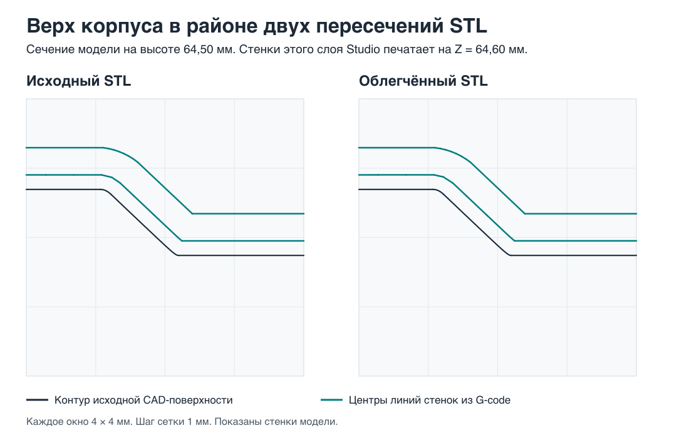

# Радио-86РК · пересечения STL и облегчённый экспорт для X2D

15 ноября 2026 года. Из 3 552 уникальных пар треугольников, отмеченных FreeCAD в исходных семи STL, пересечение или наложение подтвердилось у 15. Все 15 проходят между плоскостями нарезки Bambu Studio в испытанном положении деталей при слое 0,20 мм. Для проектирования поддержек подготовлен комплект облегчённых STL. Во всех семи файлах FreeCAD и Bambu Studio видят по одной замкнутой детали.

## Что показала проверка

| Деталь | Отметки FreeCAD в исходном STL | Подтверждённые пересечения или наложения | Максимальная протяжённость подтверждённого участка |
|---|---:|---:|---:|
| Верх | 2 474 | 2 пересечения | 0,02251 мм |
| Низ | 573 | 1 пересечение | 0,00044 мм |
| Съёмная крышка | 131 | 1 пересечение и 11 плоских наложений | 0,00431 мм |
| Две большие ножки | 165 и 170 | 0 | — |
| Две малые ножки | 18 и 21 | 0 | — |

Самая длинная отметка прежней проверки, 1,438 мм на верхе, оказалась ложной. Минимальное расстояние между этими двумя конечными треугольниками составляет 0,001656 мм. Его независимо измерил геометрический модуль FreeCAD. Настоящие пересечения верха расположены в другом месте, около X 15,5–15,9, Y −152,7…−152,4 и Z 3,2 мм в координатах сборки.

За исходные данные взяты уникальные пары из `Mesh.getSelfIntersections()`. Для каждой пары прочитаны вершины непосредственно из двоичного STL. Знаки положения относительно плоскостей, интервалы пересечения и плоские наложения проверены целочисленной и рациональной арифметикой по сохранённым координатам. Номера и координаты всех затронутых треугольников проверены при повторной записи из FreeCAD. Совпали все проверенные координаты как в исходном, так и в выбранном облегчённом комплекте. Подсчёт охватывает пары, отмеченные FreeCAD.

## Что делает Bambu Studio

Studio строит послойные контуры по сечениям сетки. Для слоя модели программа берёт плоскость посередине между его низом и верхом. Настоящее пересечение, попавшее на такую плоскость, может изменить контур и траекторию стенки. Для другой ориентации или высоты слоя проверку нужно повторить. [Построение слоёв в исходном коде установленной версии Bambu Studio](https://github.com/bambulab/BambuStudio/blob/v02.08.02.61/src/libslic3r/PrintObjectSlice.cpp#L20-L59).

Проверены профиль X2D 0,4 мм, Generic PLA, слой 0,20 мм и обычные автоматические поддержки. Верх стоит передней кромкой вниз, низ задней, обе половины развёрнуты на столе на 45°. Остальные детали в ориентации исходной сборки. Настройки исходного и облегчённого вариантов одинаковы.

На верхе два реальных отрезка находятся в диапазонах высот 64,2261–64,2264 и 64,5213–64,5226 мм. Ближайшие плоскости сечения проходят на 64,3 и 64,5 мм. Минимальное расстояние от подтверждённой области до плоскости сечения составляет 0,0213 мм для верха, 0,0373 мм для низа и 0,0076 мм для исходной крышки. Проверены фактические высоты слоёв со стенками в G-code.

В семи окнах размером 4 × 4 мм сравнили сечения принятой CAD-поверхности, двух STL и линии стенок, считанные из G-code. Проверены 27 сечений в сумме, включая участок ложной отметки и зоны реальных пересечений. Для сравнения центров линий использована центральная область 2,5 × 2,5 мм с шагом выборки до 0,02 мм. В четырёх сечениях вокруг настоящих пересечений верха максимальное выборочное расхождение между линиями стенок двух экспортов составило 0,013 мм. На всех проверенных сечениях наибольшее расхождение с исходной CAD-кривой у облегчённого STL было около 0,010 мм.



## Как облегчить экспорт

Сетка построена заново с точного BREP каждой детали в FreeCAD 1.1.4 / OpenCASCADE 7.8.1. Линейный допуск оставлен 0,015 мм, относительный режим выключен. Исходный угловой допуск 0,08 рад увеличен отдельно для каждой группы. Пробные значения 0,12 и 0,16 рад у верха дали дефекты топологии. При 0,14 рад получилась одна замкнутая оболочка. Поэтому проверяли каждый записанный STL.

| Деталь | Угловой допуск, рад | Исходные треугольники | Выбранный экспорт |
|---|---:|---:|---:|
| Верх | 0,14 | 3 481 536 | 1 133 212 |
| Низ | 0,16 | 565 558 | 161 682 |
| Крышка | 0,165 | 194 662 | 48 812 |
| Большая левая / правая ножка | 0,14 | 221 444 / 221 536 | 71 878 / 71 966 |
| Малая левая / правая ножка | 0,14 | 239 486 / 239 410 | 88 514 / 88 482 |
| **Всего** | | **5 163 632** | **1 664 546** |

Размер семи распакованных STL снизился с 258,2 до 83,2 МБ. Наибольшее отклонение габаритной границы облегчённых STL от CAD составило 0,00236 мм. Для воспроизведения нужно читать BREP детали со сборочным размещением и строить сетку следующим вызовом. Значение `angle` берётся из таблицы.

```python
mesh = MeshPart.meshFromShape(
    Shape=shape.cleaned(), LinearDeflection=0.015,
    AngularDeflection=angle, Relative=False,
)
mesh.write(output_stl)
```

В облегчённом верхе среди отмеченных пар найдено одно граничное касание. Подтверждённых пересечений и плоских наложений на верхе, днище и четырёх ножках не обнаружено. У крышки остаются два пересечения длиной до 0,00361 мм у нижней кромки. Ближайшая плоскость нарезки отстоит от них на 0,0928 мм. Для исследованного профиля оснований исправлять CAD в этих точках не выявлено.

Все семь облегчённых STL повторно прочитаны в FreeCAD, импортированы в Bambu Studio 02.08.02.61 и нарезаны на полную высоту. Время печати по прогнозу Studio для верха изменилось с 14 ч 30 мин 33 с до 14 ч 32 мин 28 с, для низа — с 12 ч 45 мин 41 с до 12 ч 48 мин 10 с. Основная выгода — меньший объём геометрии для работы в Studio. В журнале повторяются сообщения о командах T65279 и T65535 в штатном завершающем коде X2D, отмеченные и в исходной проверке.

Архив содержит семь STL в сборочных координатах и `manifest.json` с SHA-256 каждого файла, параметрами экспорта, объёмами, площадями и результатами обеих нарезок. SHA-256 принятого FCStd — `97dce455df88f7f6d51b70b9b803a53c2e82efca5e5afe93dedc5f95a970d306`. Комплект предназначен для разработки поддержек. Испытание печатью и проверка посадок на физических деталях остаются открытыми.
